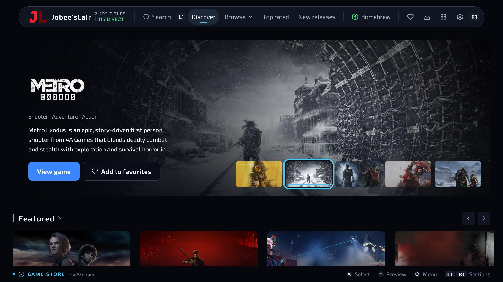
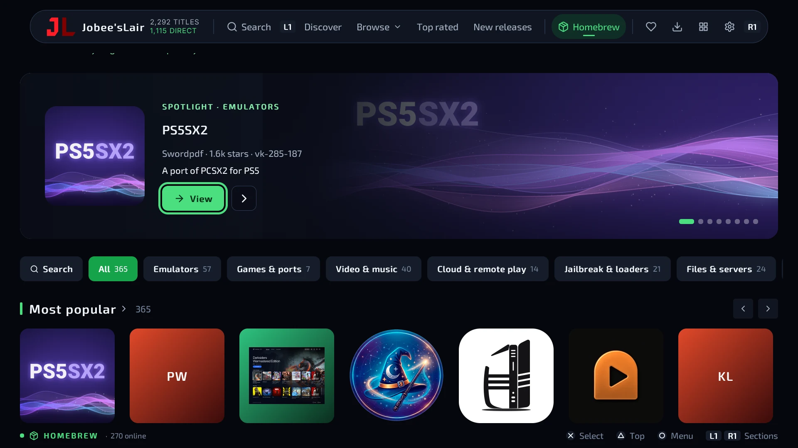
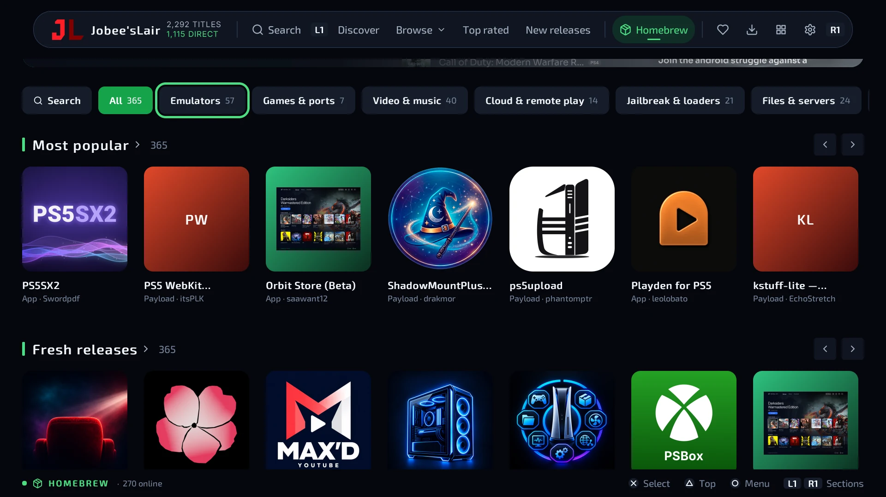
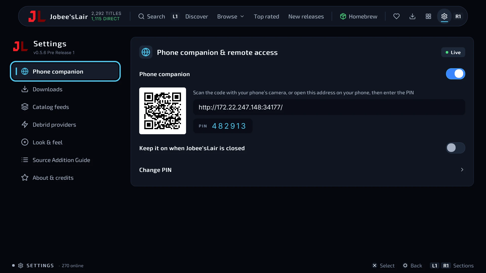
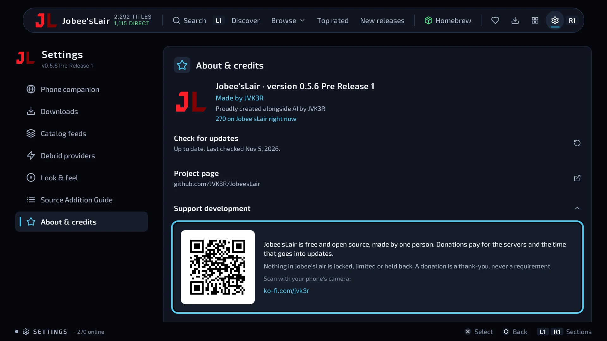
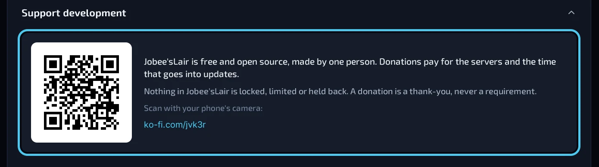

<p align="center">
  <picture>
    <source media="(prefers-color-scheme: dark)" srcset=".github/readme/logo-dark.svg">
    
  </picture>
</p>

> [!NOTE]
> **This is the glibren fork of Jobee'sLair, kept by PristMC. It is not the official build.**
> It adds, on top of Jobee'sLair 0.5.5: downloads that keep going with the app closed (`bg-downloader.elf` payload),
> mirrors, per-host connections, automatic retries and unlimited TorBox link renewal, unpacking beside the next
> download, sealed debrid keys, a lighter catalog, a format filter with "Find formats", and a Videos button that opens
> a homebrew YouTube app (ytps5 or YouTube Max'd, glibren builds). See [CHANGELOG.md](CHANGELOG.md) under "Unreleased".
> **glibren.2** adds: simultaneous downloads (1-4), the whole queue handed to the background payload, a phone page at
> `http://PS5-IP:34201` (view, pause, resume, cancel with a PIN; Android app "Jobe Controle" in the release),
> exact image types (exFAT, FFPKG...) with an exFAT filter, "TorBox only" filter and "Find via TorBox / via the browser".
> **glibren.3** fixes: closing the app with the background payload running could freeze the console. The payload now
> goes quiet for 30 s when the app closes, caps connections at 32 in total and keeps a log at `/data/JobeesLair/bg/bgdl.log`.
> **glibren.4** fixes: the TorBox/AllDebrid key could be lost if the console froze or lost power soon after a save;
> debrid.json (and the feeds, mirrors and themes) are now written through to the disk like the settings.
> **glibren.5** adds: an "Exit Jobee'sLair" button (Settings, below the categories) that tells the background payload
> before closing, and a setting to turn off the 30 s pause when the app closes.
> **glibren.6** adds: "Search TorBox" on each game's page (every file TorBox holds of the game, by code and by name,
> .exfat first, one press to queue it), a default download drive, your own list of torrent hashes (`torbox-hashes.txt`),
> and the TorBox key is no longer kept inside saved download links.
> **glibren.7** limits TorBox downloads to 8 connections in all (its CDN answered HTTP 429 to more), shared by the
> downloads running side by side.
> **glibren.8**: the in-app update downloads only the new image (no more minutes of "Checking" at 7% while update.zip
> was unpacked).
> **glibren.9**: the phone page's TorBox Library shows the games' covers and opens a page per game with photos,
> videos and details (simple list with the phone upright, detailed with it on its side); Jobe Controle 0.2.
> **glibren.10**: arrows and dots in the phone page's photo gallery, compact YouTube buttons (Trailer / Gameplay), and
> the tabs and search on one line with the phone on its side.
> **glibren.11**: with the phone on its side, the library's filters take the full width in two lines and the games stay
> in view below them.
> Download it from this fork's [releases](https://github.com/pristmc-code/JobeesLair-glibren/releases/latest);
> its in-app update reads this fork, not the official repository. It uses the same title ID (PPSA99471) and replaces
> the official app. Not yet tested on a console: report problems on this fork, not to JVK3R.
> All credit for Jobee'sLair goes to JVK3R; license unchanged (GPL-3.0-or-later).
> **glibren.12**: finished PS5 games are converted to `.exfat` on their own (originals kept in `BACKUP/`), PS4 `.pkg`
> files go to `PS4/` and install on their own, the phone page gets sections, origin/format/system chips and BACKUP
> details, and the Files tab no longer uninstalls a same-named game on another drive.
> **glibren.13**: a maximum download speed (any value in MB/s, with - / + or typed) that also holds the background
> downloads and can be changed live from the phone page; speeds shown in MB/s; the payload starts as soon as the app opens,
> so the phone page and the TorBox store are up without starting a download.
> **glibren.14**: R3 switches between the full store and the TorBox store (hint in the footer); catalog feeds without the
> limit of 3 and from a .json file on the PS5, read again at every launch; a broken TorBox copy (an error page instead of
> the game) fails once with the reason instead of renewing the link in a loop; an old payload left running is replaced.
> **glibren.15**: after an in-app update, the app is reopened only when ShadowMount+ has the new image ready (it waits,
> then tries again a few times) instead of failing with "can't start the game/app"; if it still cannot, a notification asks to open it.
> **glibren.16**: .exfat conversions shown on the PS5 Downloads screen (with Cancel conversion, also those the payload
> runs on its own); an optional warning before installing a PS5 .pkg on firmware above 11.60 (the Install button stays);
> the TorBox Library also checks downloads in parts (confirmed only with every part in TorBox).
> **glibren.17**: a download whose format only shows in its bytes (a generic .binary name) goes to BACKUP and is converted
> to .exfat like any other; a PS5 game left as a folder is converted (Files tab: Convert to .exfat); Search TorBox lists the same
> options as the sources list; the updater waits ~15 s before reopening the app.
> **glibren.18**: the background payload works on its own with Jobe closed (phone requests start, downloads in BACKUP
> are converted or extracted, "Convert now" in the phone's BACKUP list); games whose only TorBox copy is broken leave the
> TorBox store; the app update no longer waits for the payload's downloads.
> **glibren.19**: the phone page asks for the PIN once (the session is kept on the phone and by the payload for 30 days,
> renewed on use, and survives a payload restart).
> **glibren.20**: optional **Orbit Store list** (Settings > Feeds, off by default): the background payload downloads the
> public Orbit Store catalogue (GPL-3, github.com/saawant12/orbit-store-ps5) every 6 hours, decrypts it with the key
> published in Orbit's own source, and writes it as a Jobe feed on the console (PS5 and PS4 games with description and
> artwork); when it stops updating (catalogue changed, no update for 24 h, nothing new for 14 days) a PS5 notification and
> a warning bar say so. Feeds may now hold 5000 games, 20000 links and 8 MiB; "pippo" joins the known archive passwords.
> Archives that cannot be converted straight to .exfat (RAR5, passwords, missing sizes...) are now always extracted by
> the payload itself in <drive>/BACKUP/_temp/<id> and converted in the same conversion, whether Jobe or the phone asked
> (the temporary folder is deleted at the end); conversions left waiting for Jobe are resumed when the new payload starts;
> the phone's BACKUP list gets "Convert all" and "View the payload log".
> **glibren.21**: encrypted RAR archives (such as DLPSGAME's), which the payload's libarchive cannot open, are extracted
> by the app's own rar-extract.elf (RarLab's UnRAR in a separate program, as the engine does), sent by the payload to the
> payload loader, trying the known passwords; the app hands the ELF to the payload folder when it starts it.
> **glibren.22**: an app update never waits for downloads any more: while it downloads, the downloads in progress pause
> (and the queue starts nothing) and resume as soon as it is in; "Restart to apply" closes the app at once (it waits only
> for a package being installed or ShadowMount+, 3 minutes at most) and everything that was downloading or queued comes
> back by itself when the app reopens. An older background payload is replaced even while it downloads or converts (it
> saves where it was; the new one carries on). Downloads gets a **BACKUP folder** sheet: the originals the payload keeps
> in <drive>/BACKUP with what became of each, Convert / Convert all, Delete and the payload log, which only the phone
> page offered before; conversions being unpacked first show in Downloads too.
> **glibren.63**: Covers no longer vanish when scrolling back in the glibren full-screen store (download payload 1.37.7).
> **glibren.62**: Covers show again on the TV app and in the glibren full-screen store: the payload no longer drops extra connections and the TV image loader no longer breaks after a refused connection (download payload 1.37.6).
> **glibren.61**: The TorBox key is kept on the PS5 (payload folder, mode 0600): after a reboot the download payload works from the phone without opening the Jobe; removing the key in the Jobe removes it from the PS5 (download payload 1.37.5).
> **glibren.60**: Fixes from the first PS5 diagnostics: a TorBox download paused in the app resumes from the phone with the app closed; no more log storms when the network drops; dead links say "choose another source"; "Delete from TorBox and download again" for a broken TorBox copy; no crash notice after a normal power off; diagnostics from the phone carry the app info and retry; renamed games are followed; .7z extracted on several cores; cover bank filled by the phone app JobeControle 0.3-teste (not tested on a device yet) (download payload 1.37.4).
> **glibren.59**: YouTube player fixes: seeking no longer drops the quality or falls to VP9; tap = 10 s, hold to speed up, one seek when you let go; stalls are reopened and errors are explained on screen; official trailers no longer stop with "video decode failed"; the signed-in account plays again (YouTube service 0.2.3).
> **glibren.58**: Fixes from the real PS5: clear source choice on /app and the chosen source matched by id (no more "That source is no longer listed"); a download paused in the app resumes from /app with the app closed (the payload downloads it alone); a cancelled or refused request no longer stays "In the queue" on /app; an extraction cut by closing the app no longer turns the finished download back into a download (Try again converts it); extraction progress (GB, %, speed, time left, "limited by the processor") on the TV, phone page and /app. Download payload 1.37.3.
> **glibren.57**: Minimal opening: the app now opens with only the logo and a spinning ring until the store is ready. Notices and what's new moved to Settings > About; to get the old opening back, turn off Minimal opening in Settings > Appearance. Download payload 1.37.2 (unchanged).
> **glibren.56**: Fixes from the real PS5: clicking a game and the filters work in the PS5 browser (/app), covers in the PS5 browser through the payload (never from Sony), and the console's payload is replaced when the app brings a newer one. Download payload 1.37.2.
> **glibren.55**: Fixes from the real PS5: the YouTube format you pick sticks (Automatic prefers H.264), pick any source on the /app game page, AkiraBox capture, downloads that resume after a new TorBox link and a "Restart from zero" button. Download payload 1.37.1.
> **glibren.54**: The TV store reads its pages from the download payload instead of building the whole catalog in Jobe's memory (store open: 14.5 MB -> 6.8 MB); falls back to the old way when the payload is missing or older. Fixes: the payload's catalog now builds on the PS5 (two data files were missing from the image) and Jobe uses the console's real firmware. Download payload 1.37.0.
> **glibren.53**: The full Jobe on the web (store with covers, game pages, downloads and settings) at http://<PS5 IP>:34201/app, for phone, PC and the PS5 browser, in the 14 languages. Download payload 1.36.1.
> **glibren.52**: The download payload now builds the store catalog itself (bundled catalog, live catalog, your lists and the Orbit list) and the phone page's store uses it; the TV still builds its own until Phase 4. Download payload 1.36.0.
> **glibren.51**: Settings live in the download payload: the phone page can read and change them, secret keys only show as "set"; the app falls back to its own settings.json without the payload. Download payload 1.35.0.
> **glibren.50**: Phone page: per-device pairing with a 6-digit code shown on the TV (JobeControle and the phone ask for it once); the old PIN keeps working until turned off; "Paired devices" in Settings > Downloads. Download payload 1.34.0.
> **glibren.49**: Download payload: updates itself with signed releases (bg-downloader-*), switches only when idle, falls back to the previous or built-in one; "Back to the built-in payload" in Settings > About and on the phone page. Homebrew: the six darkxex apps hidden in glibren.48 are back, each with an informative line.
> **glibren.48**: Homebrew: also lists darkxex's PS5 Homebrew Catalog (one entry per app, the newer version, "darkxex" on the card; files checked by the catalog's Ed25519 signature and SHA-256); switch in Settings > Catalog feeds > Homebrew.
> **glibren.47**: Smaller image: the catalog's releases and store pages ship as two pack files read one item at a time (530 MB -> under 250 MB); new /teste page on the phone page (full screen, controller, big store, memory, rest mode).
> **glibren.46**: Signed updates: from this build on, the app installs a newer release only if its manifest is signed with the glibren key (size and SHA-256 of each file checked against it).
> **glibren.45**: Quieter when nobody is using it (fan): animations stop after 15 s idle, the catalog is built in small parts, the screen saver no longer redraws the whole screen every frame, and a "Save energy" setting.
> **glibren.44**: Less memory in the TorBox library, YouTube account always reachable, clearer download cards, diagnostics and updates from the phone, automatic updates that restart by themselves.
> **glibren.43**: App switch by the real foreground (kern.msgbuf), one TorBox pace for the whole payload, YouTube service 0.2.1 with its own DNS.
> **glibren.42**: YouTube account sign-in in Settings > Videos, safer background downloads and moves, lighter store export.
> **glibren.41**: Downloads cap while watching that expires by itself, conversions held after a crash, 149 new links and 43 new games in the catalog.
> **glibren.40**: Downloads capped at a chosen speed while a YouTube video plays.
> **glibren.39**: Default YouTube quality (1080p, 1440p or 4K) and the decoder shown in the player.
> **glibren.38**: TorBox Library on the payload, leaner store, full store on the phone, self-updating YouTube service.
> **glibren.37**: memory meter (Settings > About) and faster YouTube start.
> **glibren.36**: conversion options (pause, write limit, chunks), conversion steps logged, shutdown notice.
> **glibren.35**: glibren 0.9.6's YouTube button opens Jobee'sLair on its YouTube screen; Circle goes back to glibren.
> **glibren.34**: YouTube service updated to youtubei.js 18.3.0.
> **glibren.33**: YouTube plays inside Jobee'sLair (search, filters, quality, captions, SponsorBlock), no app switch.
> **glibren.32**: optional "Play the first video automatically" for Trailer/Gameplay (with YouTube Max'd glibren4).
> **glibren.31**: "Videos" closes Jobee'sLair and the background payload opens the video app (no more opening one app
> over another); coming back from YouTube Max'd glibren3 reopens on the same screen.
> **glibren.30**: the app update no longer fails when ShadowMount+ is busy (it uses the image path it already knows),
> and no longer says it is waiting for your downloads.
> **glibren.29**: asking TorBox about a game's links (Find formats, Find via TorBox, Instant, the library) no longer runs
> the app out of memory: smaller batches, answers read piece by piece, only the useful file names kept.
> **glibren.28**: no more freeze when a download turns into a conversion with its game page open (and a failing screen
> shows a notice instead of freezing the app), and the TorBox library saves without running out of memory.
> **glibren.27**: catalogs are read without running out of memory (the live catalog and the console's feed files one
> game at a time), the Orbit Store list carries only links for games the app already has, and feeds show the date and
> time of their last download.
> **glibren.26**: the live catalog updates on the PS5 again (broken since glibren.20 by a request size the console
> refuses), the Orbit Store list and TorBox's account take less memory (the app closed with Orbit on), the TorBox
> library no longer freezes on a call that never returns, and "Show in the store" keeps focus and the titles counter.
> **glibren.25**: the Orbit Store list now reaches the app on the PS5 (it read the wrong folder), "Check only the new
> games" in the TorBox library, a "Show in the store" switch per catalog in Settings > Catalog feeds (one left on shows
> only its games, in the full and the TorBox store), and Convert always says what happened (queue position, converting
> now, already queued, or already converted under another name).
> **glibren.23**: TorBox the way Orbit Store uses it: a quick check (Settings > TorBox, on by default) marks "TorBox
> ready" from the hosts TorBox has working with quota left today, without asking about each link (off: link by link, as
> before); the hosts' daily quota (links and data) is shown in Settings and a host out of it is not offered; the hosts
> list is read every 10 minutes; before adding a link TorBox is asked whether the account already has it, new links are
> added at most once every 61 seconds, and a "slow down" (429) waits at least 60 seconds (app and background payload).

<p align="center">
  <b>English</b> ·
  <a href="README.ru.md">Русский</a>
</p>

<p align="center">
  <b>An open-source homebrew download manager for the PS5.</b><br>
  Title ID <code>PPSA99471</code> · created by JVK3R<br>
  <i>Proudly created alongside AI by JVK3R</i>
</p>

<p align="center">
  <a href="https://github.com/JVK3R/JobeesLair/releases/latest"></a>
  <a href="https://github.com/JVK3R/JobeesLair/releases"></a>
  <a href="https://ko-fi.com/jvk3r"></a>
  <a href="https://discord.gg/w5dtAMBVgZ"></a>
</p>

<p align="center">
  <a href="INSTALLATION-GUIDE.md">Install guide</a> ·
  <a href="CHANGELOG.md">Changelog</a> ·
  <a href="FEEDS.md">Catalog feeds</a> ·
  <a href="#support-jobeeslair">Support</a> ·
  <a href="https://jobees.org">jobees.org</a> ·
  <a href="https://github.com/JVK3R/JobeesLair-PS4">The PS4 app</a>
</p>

> [!IMPORTANT]
> **All official communications are here on Discord or Twitter:**
> [Discord](https://discord.gg/w5dtAMBVgZ) · [Twitter / X (@jvk3r_)](https://x.com/jvk3r_)

> [!WARNING]
> **You are responsible for what you download.** Only download content you legally own or have
> permission to access: your own backups, homebrew, freeware. Jobee'sLair hosts and distributes
> nothing; see the [Content Neutrality & DMCA Notice](#content-neutrality--dmca-notice).

<p align="center">
  
</p>

> [!TIP]
> **Jobee'sLair is free and made by one person.** If it's useful to you, [support it on Ko-fi](https://ko-fi.com/jvk3r)
> or [with crypto](#support-jobeeslair). Donations keep the servers running and the updates coming.

Jobee'sLair is a catalog browser and download manager that runs on a jailbroken PS5 with
[ShadowMount+](https://github.com/drakmor/ShadowMountPlus). It is open source so it can't be locked away
or disappear: anyone can read, build, fix and fork it.

## What it does

- **Homebrew, its own section:** 300+ open-source PS5 apps, emulators, ports and payloads, each with its
  own art, installed and kept up to date straight from its author's GitHub release (nothing is rehosted).
  Apps land in `homebrew/` for ShadowMount+; payloads run through your ELF loader with one button.
- **Browse and download** a bundled catalog of games, plus as many catalog feeds of your own as you like (web addresses or `.json` files on the console)
  (with mirror addresses, so a feed survives its domain going down). Downloads go straight to internal
  storage or a USB drive, and the drive you picked is remembered.
- **Labels every source** before you download: what it is (Folder Dump, .exfat Image, FFPKG, Backport),
  whether it runs on firmware 13.60 (**13.60 Ready**), and whether its link still works (**Broken link**,
  **Offline**). A link that stops working for other players is flagged for you too. Nothing is hidden, only ranked.
- **Downloads that look after themselves:** a download that fails part-way retries by itself, and archives
  are unpacked for you, even an archive inside an archive.
- **Catches file links from the console's browser** for you, so there is no typing links with a
  controller, and **learns which hosts work** on your console (**Auto-capture** / **Rarely works here**).
- **TorBox and AllDebrid (optional):** add your key in Settings and supported hosts download at full speed
  with no browser step.
- **Library, play time and Make Room:** see what's installed and how long you played it, free up space
  safely, move games between drives, and find out **why a game won't start**, with how often it starts for
  other players.
- **Phone companion:** a live dashboard, the queue, games and homebrew (install, update, run, remove), your
  library with Fix it, and a remote, from your phone, in the console's language. Downloads and installs move on
  the phone as they happen. Off until you turn it on, and you choose its 6-digit PIN. Experimental: it can stay
  reachable while Jobee'sLair is closed, to open the app or run a payload.
- **Types on the PS5's own keyboard** for searches, links and keys, in your language (or the store's own keys,
  with results as you type, if you prefer them).
- **Updates from the app**, a **download speed limit**, six accent colors, DualSense light-bar status,
  and 14 languages.

<p align="center">
  
  
</p>

<p align="center">
  
  
</p>

## Support Jobee'sLair

Jobee'sLair is free and open source, and it's made by one person. Donations pay for what keeps it running: the
servers behind the live catalog, the update checks and the bug reports, and the time each release takes. Nothing in
the app is locked or held back, and nothing ever will be. A donation is a thank-you, never a requirement.

<p align="center">
  <a href="https://ko-fi.com/jvk3r"></a>
</p>

| How | Where |
| --- | --- |
| **Ko-fi** | [ko-fi.com/jvk3r](https://ko-fi.com/jvk3r): card, Apple Pay or Google Pay, once or monthly |
| **Bitcoin** | `3PeEqA8UTvCuLwR1K5NKP8k11dFAh14rqM` |
| **USDC on Solana** | `6iWHFuvmBgZtUsyF3GmrF2Ng4tAPnBaEJkD8tr7Hm3cX` |

Supporters are thanked by name on [jobees.org/#support](https://jobees.org/#support) (a private gift stays private)
and get the Supporter role on [Discord](https://discord.gg/w5dtAMBVgZ). Gave in crypto? Open a ticket there with the
transaction link.

From 0.5.6 the same Ko-fi code is in the app, under **Settings → About & credits → Support development**:

<p align="center">
  
</p>

## Install

Full steps are in the **[installation guide](INSTALLATION-GUIDE.md)**. In short:

1. Have a **jailbroken PS5** running **ShadowMount+**.
2. Copy `JobeesLair.exfat` into a folder named `homebrew` on an exFAT USB drive (or `/data/homebrew`).
3. Plug it in. ShadowMount+ installs it. Open **Jobee'sLair** from the home screen.

> [!IMPORTANT]
> The phone companion asks you to choose a PIN before it turns on. Pick one you don't use elsewhere, and
> keep the companion off on a shared or public network.

## Content Neutrality & DMCA Notice

Jobee'sLair is a user-driven download tool, not a content service.

- **No copyrighted files are hosted here:** not on a project server, not in this repository, not in the app
  image. Your console fetches files directly from the third-party addresses you choose.
- **The bundled catalog** (`app/data/`) is an index of titles, descriptions, cover links and references to
  third-party addresses. It is not the files, and the project does not run or vouch for those servers.
- **Your feeds and mirrors are yours.** They are fetched and read on your console. The project runs no feed
  server and does not see what you add or download.

**To report an infringing catalog entry, feed or mirror,** open a
[takedown issue](https://github.com/JVK3R/JobeesLair/issues/new?template=takedown.yml) or use GitHub's
[DMCA process](https://docs.github.com/en/site-policy/content-removal-policies/dmca-takedown-policy), naming
this repository. Include the work and its owner, where the entry is (its file and title ID, or the exact
address), your contact details, a good-faith statement that the use is not authorized, and a statement under
penalty of perjury that the notice is accurate and you are the owner or authorized to act. A complete notice
is reviewed promptly and the entries it identifies are removed in a following release. A feed hosted by
someone else is outside the project's control; send the notice to its host too. A counter-notice is handled
as the DMCA and GitHub's process provide.

This notice is not legal advice and does not change the [LICENSE](LICENSE).

## Videos (homebrew YouTube app)

**Videos** on a game's page opens a homebrew YouTube app on a search for that game, its gameplay or its trailer.
It works with [ytps5](https://github.com/pristmc-code/ps5-glibren-releases) (`PPSA99350`, preferred) or
YouTube Max'd (`PPSA99991`) builds that read `glibren_busca.txt`; the official YouTube app is never opened.

1. The app is found by `/data/homebrew/<title ID>/eboot.bin` (or its `/user/appmeta` entry and that folder).
   Without one, the sheet says how to install it and nothing else happens.
2. `"<name> gameplay"` (or `trailer`), one UTF-8 line of at most 200 bytes, is written to
   `/data/homebrew/<title ID>/glibren_busca.txt.tmp` and renamed to `glibren_busca.txt`. The app reads it when it
   opens (and about every second while open), deletes it and shows the results.
3. `companion-daemon.elf` is sent to the payload loader (port 9021) with the request `LNC1`, the title ID and the
   payload folder. It launches that title (`sceLncUtilLaunchApp`) without closing anything, writes `launched`,
   `running` or `failed 0x<code>` to `launch.txt` there, and exits. Errors are shown in the sheet.

Code: `app/state/youtube.js`, `app/game/VideosSheet.jsx`, `app/native/companion_daemon.c`; tests:
`tests/youtube.test.mjs`, `tests/render/videos.mjs`.

## Build it yourself

<details>
<summary><b>Repository layout and build steps</b></summary>
<br>

| Path | What it is |
| --- | --- |
| `app/` | The application (JSX, state, catalog data) and `app.json` (title ID `PPSA99471`) |
| `ps5-react/` | The framework it runs on, vendored from [JVK3R/ps5-react](https://github.com/JVK3R/ps5-react), the continuation of half144's PS5 React |
| `tests/` | The app's tests and benchmarks |
| `packaging/` | Builds the exFAT image and adds these docs to it |
| `INSTALLATION-GUIDE.md`, `FEEDS.md`, `CHANGELOG.md` | Install steps, the feed format, what changed |

On Linux (or WSL) with `clang-18`, `llvm-18`, `cmake`, `ninja-build`, `nodejs`, `npm`, `zlib1g-dev`,
`build-essential`, `pkg-config`, `unzip`, `curl`, `exfatprogs` and Pillow (`ps5-react/requirements.txt`):

```sh
node tools/catalog/catalog-index.mjs   # only after editing app/data/catalog.js; the tests check it is current
node tools/catalog/data-pack.mjs      # after app/data/releases or app/data/pages change (catalog-index and formats run it too)
cd ps5-react
python3 tools/build_ps5.py --app-dir ../app --llvm /usr/bin
cp -a dist/PPSA99471 ../stage
../packaging/stage-docs.sh ../stage
sudo ../packaging/make-exfat.sh ../stage ../JobeesLair.exfat JOBEESLAIR
```

The tests need only Node.js 22+ and run on every push: `npm test` (logic), `npm run test:render`
(screens), `npm run test:all` (both).

The Homebrew section's list is nexgen999's [PS5 Repository List](https://github.com/nexgen999/PS5-Repository-List),
read live, plus our own picks and categories. It is built from each project's own GitHub data every six hours
in its own repository, [JVK3R/JobeesLair-Homebrew](https://github.com/JVK3R/JobeesLair-Homebrew), which
consoles read directly; `npm run homebrew:pull` refreshes the copy shipped in the app (`app/data/homebrew.json`)
before a release. The same repository is the home of **Jobee'sLair Homebrew**, the Homebrew section built on its
own (`packaging/homebrew-edition.sh`, title `PPSA99472`), which installs beside the store.

Since glibren.48 the section also lists the [PS5 Homebrew Catalog](https://github.com/darkxex/ps5-homebrew-catalog)
by darkxex (GPL-3.0-or-later; https://prosperostore.net), read live from its `catalog/v1.json` feed and joined to the
list above (one entry per app, the newer version, "darkxex" on its card). Before installing one of its files the app
checks it against the catalog's signed API (`api/v1/manifest.json` + `manifest.sig`, Ed25519) and the native download
checks the file's SHA-256. Only the catalog's data is used, none of its code. Settings > Catalog feeds > Homebrew turns
it off.

To publish: raise the version in `app/version.js`, build, test the image on a console, then publish a
release tagged with the same version (`v0.5.0`). Attach `JobeesLair.exfat` and `update.zip`
(`ps5-react/dist/PPSA99471.zip` renamed) so installed copies can update themselves.

</details>

## Credits

- **JVK3R**, creator of Jobee'sLair
- **drakmor** ([ShadowMount+](https://github.com/drakmor/ShadowMountPlus))
- **nexgen999** ([PS5 Repository List](https://github.com/nexgen999/PS5-Repository-List)): the Homebrew section's
  list comes from it, with their permission, and grows with it
- **darkxex** and the catalog's maintainers ([PS5 Homebrew Catalog](https://github.com/darkxex/ps5-homebrew-catalog),
  GPL-3.0-or-later): the Homebrew section's second list (data only)
- **Every homebrew developer** whose work the Homebrew section lists
- **PS5 React — created by half144 and PS5 React contributors.**
  The original repository is gone; the framework continues at
  [github.com/JVK3R/ps5-react](https://github.com/JVK3R/ps5-react), where the changes made for Jobee'sLair live.
- **StonedModder** ([ps-game-state-lib](https://github.com/StonedModder/ps-game-state-lib), MIT): the idea of reading
  the foreground app from kern.msgbuf, used by the app switch of the background payload
- **Nick** and **all testers**: thank you

Distributed under the GPL-3.0-or-later ([LICENSE](LICENSE)). Third-party notices are in `notices/` inside the
app and in `ps5-react/docs/DEPENDENCIES.md`.
